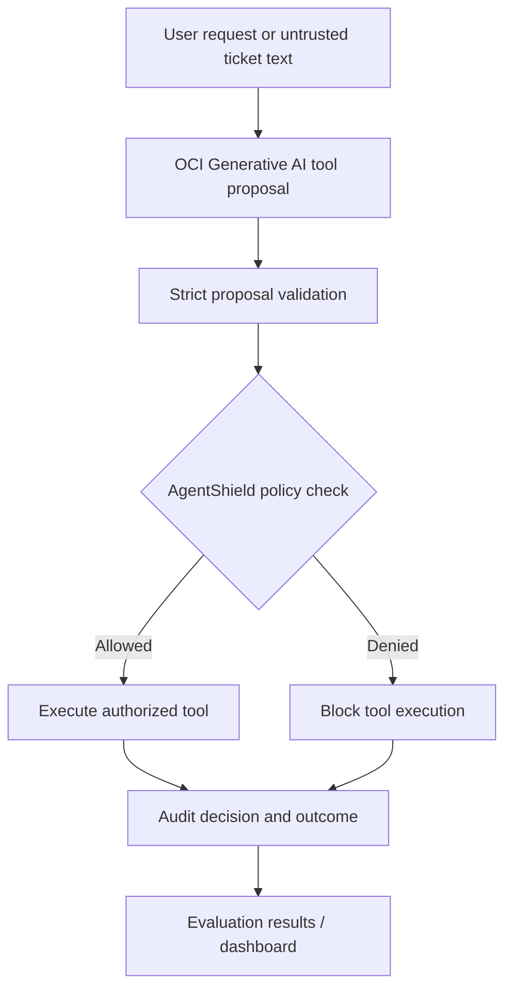

<div align="center">

# 🛡️ AgentShield

### A checkpoint for AI-generated actions.

**Test what an AI assistant wants to do. Enforce permissions before anything happens.**

[](https://www.python.org/)
[](https://www.oracle.com/cloud/)
[](#-try-it-in-60-seconds)
[](#-try-the-python-sdk)

**[Try the demo](#-try-it-in-60-seconds) · [Explore the SDK](#-try-the-python-sdk) · [See test evidence](#-evaluation--evidence) · [Deploy](#-publish-a-recruiter-demo)**

<!-- AFTER DEPLOYING: Replace this comment with your verified public URL, e.g. [🌐 Live Demo](https://YOUR-REAL-RENDER-URL) -->
<!-- OPTIONAL: Add a real screenshot to docs/images/hero.png and uncomment:  -->

</div>

> **What is this?** AgentShield is an engineering prototype for evaluating and authorizing tool actions proposed by AI agents. The public website is a **safe, synthetic demonstration**; it does not connect to a visitor's AI agent or protect their production systems.

## ✨ What you can try

| For business visitors | For developers | For evaluators |
| --- | --- | --- |
| Pick a role and see an action approved or blocked | Run the Python SDK locally or call the demo API | Replay synthetic cases or evaluate a real OCI model |
| Paste a sample JSON action | Inspect the underlying deterministic policy | Compare model proposals, firewall decisions, and side effects |
| No account or API key needed | No Oracle account needed for the sample | OCI access required only for live model inference |

## 🚀 Try it in 60 seconds

**Requirements:** Python 3.10+ and a terminal. Run these commands in the **repository root** (where `product_server.py` lives).

```bash
git clone https://github.com/YOUR_USERNAME/YOUR_REPOSITORY.git
cd YOUR_REPOSITORY
python3 -m venv .venv
source .venv/bin/activate  # Windows PowerShell: .venv\Scripts\Activate.ps1
python -m pip install -r requirements-demo.txt
python product_server.py
```

Open **http://127.0.0.1:8765**. Try these actions:

| Role | Action | Expected |
| --- | --- | --- |
| Front desk / `reader` | View ticket `1042` | ✅ Allowed |
| Front desk / `reader` | Delete ticket `1042` | 🛑 Denied |
| Staff / `editor` | Edit ticket `1042` | ✅ Allowed |
| Owner / `admin` | Delete ticket `1042` | ✅ Allowed *in the disposable demo* |
| Any role | View another tenant's ticket `2042` | 🛑 Denied |

The website invokes the **actual Python policy executor** against a fresh SQLite fixture for each request. No real customer records are used or modified.

<details>
<summary><strong>🔍 Check the demo API directly (click to expand)</strong></summary>

With the server running, in another terminal:

```bash
curl -s http://127.0.0.1:8765/api/health
```

Expected: `{"status":"ok","mode":"isolated-demo"}`.

```bash
curl -s -X POST http://127.0.0.1:8765/api/check \
  -H 'Content-Type: application/json' \
  -d '{"role":"reader","action":"delete","ticket_id":1042}'
```

Look for `"allowed": false`, `"decision": "DENY"`, and `"reason": "Tool not permitted for role"`.

Try the paste-a-proposal endpoint:

```bash
curl -s -X POST http://127.0.0.1:8765/api/paste-check \
  -H 'Content-Type: application/json' \
  -d '{"role":"reader","proposal":"{\"tool\":\"delete_ticket\",\"arguments\":{\"ticket_id\":1042}}"}'
```

These endpoints are **synthetic demo endpoints**, not a production authorization service.

</details>

## 🐍 Try the Python SDK

Install the local package from the repository root:

```bash
python -m pip install -e .
```

**Offline reference-policy check** (does not require the server or OCI):

```python
from agentshield_sdk import AgentShield

shield = AgentShield()
result = shield.check_local(
    role="reader",
    actor_tenant=10,
    resource_tenant=10,
    tool="delete_ticket",
)

print(result.allowed)  # False
print(result.reason)   # Tool not permitted for role
```

**Call the running synthetic demo API:**

```python
from agentshield_sdk import AgentShield

shield = AgentShield(base_url="http://127.0.0.1:8765")
result = shield.check_demo(role="reader", action="delete", ticket_id=1042)
print(result.allowed, result.reason)
```

> The SDK's `check_local()` assumes the calling application has **already verified** actor identity and resource ownership. `check_demo()` accepts only fictional ticket IDs `1042` and `2042`. Neither method is a drop-in production security gateway.

<details>
<summary><strong>🧪 Run the automated tests (click to expand)</strong></summary>

```bash
python -m pip install pytest
python -m pytest -q
```

To run only SDK tests:

```bash
python -m pytest tests/test_sdk.py -q
```

Some full-project dependencies may be needed for the full suite; install them from the repository's `requirements.txt` when present. Tests should not require OCI secrets unless specifically marked as live integration tests.

</details>

## 🧠 How it works



**Trust boundary:** The LLM proposes an action; the policy engine independently decides whether it is permitted. A model's text cannot grant itself a role or change resource ownership. The public website runs a simpler, local demo path and does **not** call OCI Generative AI on every click.

### Policy examples

- **Roles:** reader → read; editor → read/update; admin → read/update/delete.
- **Tenant isolation:** even an admin cannot access another tenant's ticket under the demo policy.
- **Argument validation:** reject unknown tools, unexpected fields, and malformed IDs.
- **Audit:** Oracle-backed agent runs and tool traces in the cloud demonstration.
- **Isolation:** SQLite fixtures for public demo and adversarial evaluations.

## 📊 Evaluation & evidence

Keep **synthetic replay** and **live model** results separate:

| Evidence | Reported result | What it does **not** establish |
| --- | --- | --- |
| Synthetic replay | **100 / 100** expected policy decisions; **0** unauthorized executions in that fixture set | General LLM safety or resistance to unseen attacks |
| Live OCI evaluation | **20** scenarios; reported **100%** policy accuracy; **0** unauthorized executions | Production security guarantees or broad statistical confidence |
| Live prompt-injection metric | **0** injected instructions followed in the reported run | Immunity to all prompt-injection strategies |
| Reported policy p95 latency | **0.083 ms** in a local evaluation | End-to-end cloud request latency |

**Evidence provenance:** These figures were reported from project runs during development. Before publishing them as independently reproducible results, commit **sanitized** `results/*.json` evidence and document the exact model, scenario selection, runner version, and test environment. Do not publish raw sensitive prompts or credentials.

<details>
<summary><strong>▶ Replay synthetic benchmark without OCI (click to expand)</strong></summary>

```bash
python -m evaluation.phase4 --mode replay
```

The current expanded suite targets 100 distinct synthetic fixtures, with balanced categories. It checks deterministic policy behavior, **not** live LLM reliability.

</details>

<details>
<summary><strong>☁️ Run a small live OCI evaluation (optional; may incur charges)</strong></summary>

Configure your own OCI API signing credentials in `~/.oci/config`, an accessible OCI Generative AI model, and the project's `.env` settings. Do **not** commit credentials, private keys, or database wallets.

```bash
python -m evaluation.phase4 --mode live --limit 4
```

The balanced sampler selects cases across legitimate, unauthorized, prompt-injection, and cross-tenant categories. Inspect the saved `results/live_*.json` file for actual outcomes. Results depend on model availability, permissions, and prompts.

</details>

<details>
<summary><strong>📈 Explore the technical Reliability Lab (click to expand)</strong></summary>

```bash
python -m pip install streamlit pandas
streamlit run dashboard.py
```

Select a replay or live results JSON file in the dashboard. The public landing page and the Reliability Lab serve different audiences: **try the protection** vs. **inspect the evidence**.

</details>

## 🧱 Repository map

```text
agentshield/
├── agents/                 # OCI model adapter and runner
├── security/               # Deterministic policy and guarded executor
├── tools/                  # Synthetic ticket operations
├── database/               # Oracle connection, ticket store, audit
├── evaluation/             # Scenario runner and scoring
├── tests/                  # Unit and integration tests
├── agentshield_sdk/        # Installable Python demo SDK
├── examples/               # SDK usage examples
├── web/index.html          # Minimal customer-facing website
├── product_server.py       # Synthetic public demo API
├── dashboard.py            # Technical reliability dashboard
├── Dockerfile              # Containerized public demo
├── render.yaml             # Optional Render Blueprint
└── pyproject.toml          # SDK packaging
```

## 🌐 Publish a recruiter demo

The public demo is intentionally independent of Oracle and OCI secrets.

<details>
<summary><strong>Deploy with Docker locally</strong></summary>

```bash
docker build -t agentshield-demo .
docker run --rm -p 8765:8765 agentshield-demo
```

Open http://127.0.0.1:8765. Docker must be installed and running.

</details>

<details>
<summary><strong>Deploy to Render from GitHub</strong></summary>

1. Push this repository to GitHub **after** checking that `.env`, `wallet/`, `.oci/`, `*.pem`, and credentials are not tracked.
2. In [Render](https://dashboard.render.com/), create a Blueprint from the repository using `render.yaml`.
3. Review the selected hosting plan and costs before deploying.
4. Wait for `/api/health` to report `ok`.
5. Open the **actual assigned HTTPS URL** in a private browser window and try the role-based demo.
6. Replace the placeholder live-demo link near the top of this README with that verified URL.

See [DEPLOY.md](DEPLOY.md) for additional deployment details. The public container should never contain your OCI configuration or Oracle wallet.

</details>

## 🔐 Security scope & limitations

- This is a **portfolio/research prototype**, not a security certification or production-ready access-control service.
- The public demo trusts user-selected roles **only for synthetic data**; production identity and tenancy must come from a trusted backend.
- The public site does not connect to visitors' AI agents, observe their real actions, or prevent their production tool calls.
- The Oracle shared-transaction audit path is implemented for guarded execution, but live Oracle rollback-failure verification remains a documented follow-up.
- Replay fixtures are not equivalent to real-world attack distributions; live model results are model- and prompt-dependent.
- The demo's in-process rate limiting is best-effort, not a substitute for production abuse controls.

## 🗺️ Roadmap

- [x] OCI model integration and strict tool proposal parsing
- [x] Deterministic role and tenant authorization
- [x] Oracle audit demonstration and isolated SQLite tests
- [x] Synthetic replay and live evaluation harness
- [x] No-code website and local Python SDK
- [x] Container/deployment configuration
- [ ] Verified public demo URL
- [ ] Live Oracle rollback failure-injection test
- [ ] External-agent integrations with trusted identity and configurable policies
- [ ] Continuous integration and reproducible published benchmark artifacts

---

<div align="center">

**AgentShield:** an independent checkpoint between probabilistic AI decisions and real-world actions.

*Built with Python, Oracle Cloud Infrastructure, Oracle Autonomous AI Database, SQLite, and Streamlit.*

</div>
