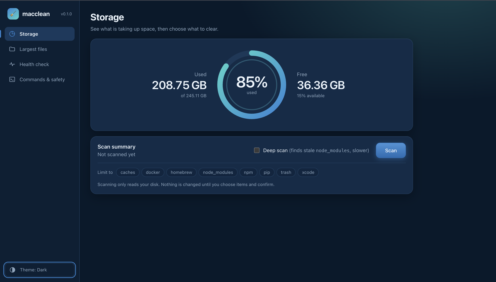

<div align="center">

# 🧹 macclean

**Find what is eating your Mac's disk. Delete only what you approve.**

A safe, developer-focused storage cleaner for macOS, with a CLI and a local web dashboard.


<br>



</div>

<br>

## Why macclean

Xcode, Homebrew, npm, pip and Docker quietly fill a developer's disk with tens of gigabytes of caches. Most cleaners either guess or ask you to trust them. macclean does neither.

- **It explains every item.** You see what it is, where it lives, and what happens if it is gone.
- **It never deletes by default.** Every command is a dry run until you ask otherwise.
- **It cannot touch your files.** Documents, Desktop, Downloads, Photos, iCloud Drive, keychains and `.ssh` are protected by a single guard that every deletion must pass.

## See it work

<div align="center">


</div>

## Quick start

```bash
git clone https://github.com/<your-username>/macclean.git
cd macclean
python3 -m venv .venv && source .venv/bin/activate
pip install -e .

macclean web
```

That opens the dashboard at `http://127.0.0.1:8765`. Press **Scan**, review the list, and nothing changes until you confirm.

Prefer the terminal?

```bash
macclean scan              # what is using space (changes nothing)
macclean clean             # dry run: shows exactly what would be removed
macclean clean --execute   # delete SAFE items after a confirmation prompt
```

## What it finds

| Source | What is cleaned | Level |
|---|---|---|
| Xcode | DerivedData | Safe |
| Xcode | iOS DeviceSupport | Review |
| Xcode | Archives, iOS simulators | Report only |
| Homebrew | Download cache | Safe |
| npm | `~/.npm/_cacache` | Safe |
| pip | `~/Library/Caches/pip` | Safe |
| App caches | Anything over 50 MB in `~/Library/Caches` | Review |
| Trash | Emptied permanently | Review |
| Docker | Build cache, unused images | Review |
| Docker | Volumes | Dangerous, never cleaned |
| `node_modules` | Projects untouched for 90+ days (`--deep`) | Report only |

## The dashboard

```bash
macclean web                # opens http://127.0.0.1:8765
macclean web --port 0       # pick any free port
macclean web --no-browser   # just print the address
```

The dashboard runs on the same engine as the CLI. It does not add a single new way to delete anything.

- **Storage.** A usage ring for your disk, a scan summary, and results grouped into *Safe to clean*, *Review first* and *Report only*.
- **Largest files.** Find big files in your home folder. Report only.
- **Health check.** Confirms the tools and permissions macclean needs, including Full Disk Access.
- **Commands & safety.** The legend for each safety level, plus every Terminal command, one click to copy.
- **Light and dark.** Follows your system, or switch it from the sidebar.

### How the dashboard stays safe

- Listens on `127.0.0.1` only, never the network.
- A random token is generated on every launch and required on every API call.
- Requests with an unexpected `Host` or `Origin` header are refused, which blocks DNS rebinding and cross-site requests.
- The browser can only clean items **by id**, and only items from the latest scan. It can never send a path to delete.
- Deleting needs `dry_run: false` **and** `confirm: true`. A request that omits both is a dry run.
- Only a fixed list of static files is served, under a strict Content-Security-Policy.
- Largest files only searches inside your home folder.

## Command reference

```bash
macclean scan                          # what is using space (changes nothing)
macclean scan --deep                   # also find stale node_modules (slower)
macclean clean                         # DRY RUN: shows exactly what would be removed
macclean clean --execute               # delete SAFE items after a confirmation prompt
macclean clean --include-review --execute
macclean clean -c xcode -c npm         # limit to categories
macclean largest ~/ -n 20              # biggest files (report only)
macclean doctor                        # check tools and permissions
macclean web                           # open the dashboard
```

What the CLI looks like:

```text
$ macclean scan

 Safety      Item                  Size       Action
 ✓ SAFE      Xcode DerivedData     8.42 GB    cleanable
 ✓ SAFE      npm cache             2.71 GB    cleanable
 ! REVIEW    Docker build cache    6.83 GB    needs --include-review
 ! REVIEW    Xcode Archives        4.18 GB    report only
```

## Safety model

| Level | Meaning | Behavior |
|---|---|---|
| **Safe** | Regenerable build and package caches | Cleaned by `clean --execute` |
| **Review** | Probably fine, but look first | Needs `--include-review` |
| **Dangerous** | Could lose real data | Reported only, never cleaned |

Guarantees, all covered by tests:

- Dry run is the default. Nothing is deleted without `--execute` plus confirmation (or `--yes`).
- Every deletion goes through one guard, `utils.check_deletable`. It refuses anything outside your home folder, your home folder itself, `Documents`, `Desktop`, `Downloads`, `Pictures`, `~/Library/Application Support`, iCloud Drive, keychains, `.ssh`, and more.
- Symlinks are removed as links, never followed.
- Xcode Archives, iOS simulators, large files and stale `node_modules` are report-only.
- No root, no `sudo`, no daemon, no network.

## Architecture

```text
macclean/
├── cli.py            argparse commands (scan, clean, largest, doctor, web)
├── scanner.py        runs cleaners in parallel, selects items for cleaning
├── cleaning.py       hands items to their cleaners and combines the results
├── health.py         the checks behind `doctor` (shared by CLI and dashboard)
├── models.py         Safety, CleanableItem, CleanResult
├── presentation.py   display_path / describe_target text shared by CLI and web
├── utils.py          sizes, deletion guard, subprocess helpers
├── ui.py             Rich tables and panels
├── largest.py        big-file finder
├── cleaners/         one file per source of reclaimable space
│   ├── base.py       Cleaner ABC: scan() and clean()
│   └── xcode.py homebrew.py npm.py pip.py docker.py trash.py user_caches.py node_modules.py
└── web/              the dashboard
    ├── server.py     HTTP only: localhost bind, token, Host/Origin checks, static files
    ├── routes.py     path -> function table for the JSON API
    ├── service.py    what the dashboard can do (no HTTP knowledge)
    ├── body.py       validated access to a JSON request body
    ├── payloads.py   domain objects -> the JSON app.js expects
    ├── errors.py     ApiError (message + HTTP status)
    ├── index.html    page template ({{TOKEN}} is filled in per launch)
    └── static/       style.css, app.js
```

The front end is plain HTML, CSS and JavaScript with no build step. All server data is rendered with `textContent`, never `innerHTML`, so an oddly named file cannot inject markup.

### Add a cleaner

```python
from macclean.cleaners.base import Cleaner
from macclean.models import Safety

class CargoCleaner(Cleaner):
    name = "cargo"

    def scan(self):
        item = self.dir_item(
            self.home / ".cargo" / "registry" / "cache",
            "Cargo registry cache", Safety.SAFE, contents_only=True,
        )
        return [item] if item else []
```

Register it in `cleaners/__init__.py`. The base class handles dry runs, the confirmation flow, command items, and the deletion guard.

## Development

```bash
pip install -e ".[dev]"
pytest
# or, without pytest:
python3 -m unittest discover -s tests
```

## Roadmap

- [ ] Per-item interactive selection in `clean` (the dashboard already has it)
- [ ] `--json` output
- [ ] SwiftUI app with a storage treemap, sharing the same safety model

## License

MIT
